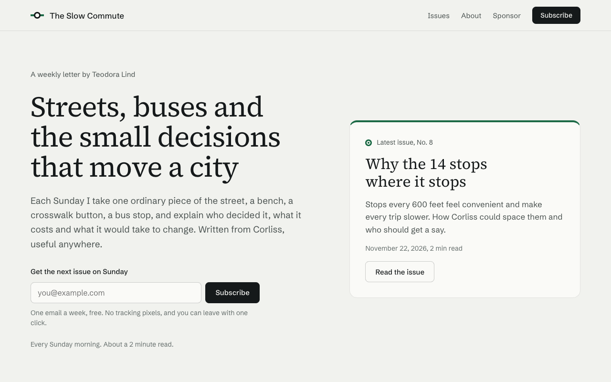

# The Slow Commute: newsletter website template

A home for a newsletter: a subscribe form, an archive of past issues with a page for each one written in Markdown, an about page for the writer, sponsorship info and an RSS feed. Built with Astro as a static site. The demo is a fictional weekly letter about streets and transit.



[](https://console.cloudzyro.com/new?repo=https://github.com/Cloudzyro/template-newsletter)

## What's included

- Home page with the subscribe form, the latest issue and the four before it
- Issue archive grouped by month, drawn as a transit line with each issue as a stop
- A page per issue from Markdown, with reading time, an optional sponsor note placed after the first section, the subscribe form and links to the previous and next issue
- About the writer, and a sponsor page with audience figures, slots and rates, and past sponsors (all marked as sample)
- Subscribe form that posts to your newsletter provider or form service, or offers an email link when none is set
- RSS feed at `/rss.xml` with the full text of each issue
- SEO: titles and descriptions per page, Open Graph and Twitter tags, sitemap, `robots.txt`, favicon
- Self-hosted fonts (Source Serif 4 and Schibsted Grotesk through Fontsource), no third-party scripts, no tracking
- Responsive down to 360px, visible focus styles, reduced motion respected

## Run it locally

```bash
pnpm install
pnpm dev        # http://localhost:4321
pnpm build      # static site in dist/
pnpm preview    # serve the built site
```

## Make it yours

- **Issues:** one Markdown file per issue in `src/content/issues/`. The front matter has `number`, `title`, `dek` (one sentence for lists, RSS and social cards), `date`, an optional `sponsor` (`name`, `text`, `href`) and `draft: true` to hide one.
- **Everything else the reader sees:** `src/data/site.ts` (name, home text, the writer's bio, subscribe wording, sponsor rates and audience). The audience figures, rates and past sponsors are sample data: replace them with your own.
- **Subscribe form:** set `PUBLIC_FORM_ENDPOINT` to the address your newsletter provider or form service gives you (Buttondown, Formspree, Basin, a Supabase function or similar). The form posts one field, `email`. Without it, the form shows a note and an email link so readers can still sign up.
- **Your address on the web:** set `SITE_URL` (or edit the fallback in `astro.config.mjs`) so the sitemap, RSS feed and social cards use absolute links.
- **Colors and fonts:** the variables at the top of `src/styles/global.css`. The route color is `--accent`.
- **Social card and icon:** replace `public/og.png` (1200x630) and `public/favicon.svg`.

Copy `.env.example` to `.env` for local work. Both variables are optional and read at build time.

| Variable | What it does |
| --- | --- |
| `PUBLIC_FORM_ENDPOINT` | Where the subscribe form posts |
| `SITE_URL` | Your public address, for the sitemap, RSS and social cards |

## Deploy

Click the **Deploy to Cloudzyro** button above, or push your own copy to GitHub and connect it in the Cloudzyro console. The build command is `pnpm build` and the output folder is `dist`. No server is needed.

## Stack

- [Astro](https://astro.build) 7 with content collections
- `@astrojs/rss` and `@astrojs/sitemap`
- Plain CSS with custom properties
- TypeScript

## License

MIT, see [LICENSE](./LICENSE).
